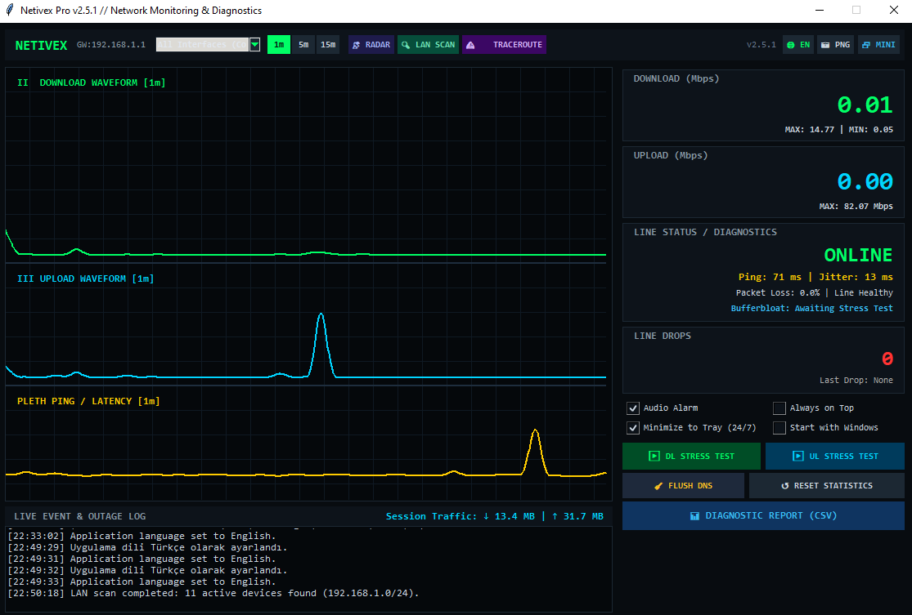
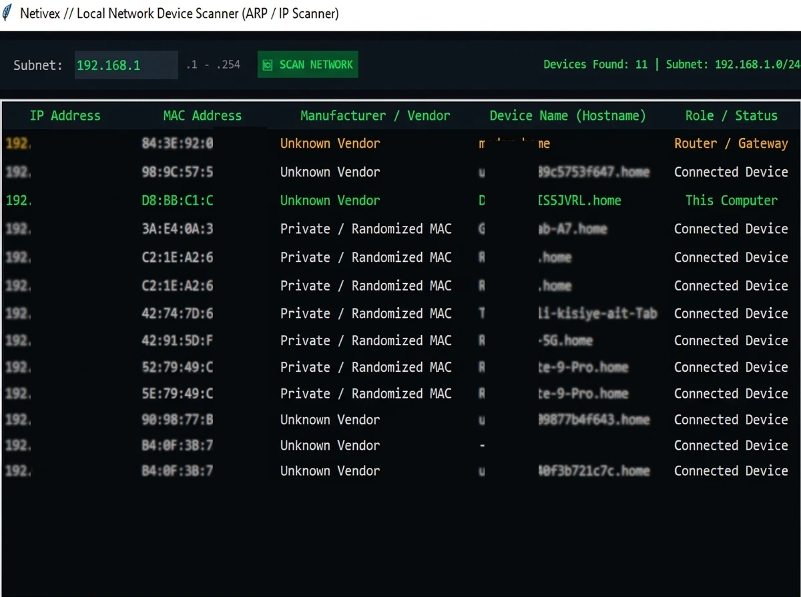
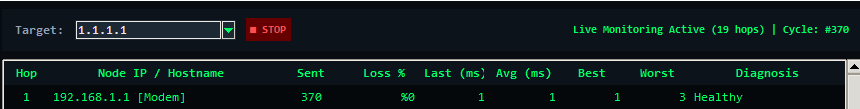

  
  <h1>Netivex Pro v2.5.1</h1>
  
<strong>Real-Time Network Monitoring, Outage Diagnostics & Bandwidth Analysis Monitor for Windows</strong>

  

    
    
    
  

---

## 📌 About

**Netivex Pro** is an advanced network diagnostics monitor for Windows that tracks real-time speed fluctuations, connection drops, packet loss, and background bandwidth-consuming applications at the **Windows Kernel (ETW)** level. Whenever a disconnection occurs, it instantly determines whether the issue originates from your **local network/modem** or your **Internet Service Provider (ISP)**, and generates CSV reports ready to be presented as proof.

---

## 🖼️ Screenshots

  
  
<em>Live ECG Waveform, Ping/Jitter Analysis & Outage Log</em>

| Application Network Radar (ETW) | Local Network Scanner (LAN) | Live Traceroute (Hop-by-Hop) |
| :---: | :---: | :---: |
|  |  |  |

---

## 🚀 Features

- **📈 Live ECG Waveform:** Monitor Download, Upload, and Ping metrics on a real-time chart across 1m, 5m, and 15m time scales.
- **🔍 Smart Fault Source Detection:** Automatically pings your local gateway upon disconnection to distinguish between `LOCAL NETWORK / MODEM` and `ISP / EXTERNAL LINE` outages, complete with an audio alarm.
- **📡 Application Network Radar (Kernel ETW):** Leverage the Windows kernel engine to inspect exact per-process (`.exe`) Download/Upload speeds in Mbps/KB, view remote IP endpoints, and terminate unwanted tasks with a single click.
- **🌐 Local Network Device Scanner (LAN / Wi-Fi Scanner):** Discover all devices connected to your router with IP, MAC address, Hostname, and manufacturer lookup (Apple, Xiaomi, Samsung, TP-Link, Hikvision, Dahua, etc.).
- **🛤️ Live Traceroute Analysis:** Continuously trace every intermediate node (hop) to a target server to pinpoint exactly where latency spikes or packet loss begin.
- **⚡ Line Stress Test & Bufferbloat Grading:** Run multi-channel Download/Upload stress tests to measure latency under load and receive a quality grade from **A+ to D**.
- **📊 ISP Proof Report (CSV) & Practical Utilities:** Export all outage timestamps and durations to an Excel-compatible CSV file, flush Windows DNS cache (`flushdns`) in one click, capture PNG screenshots, and use Mini Mode or 24/7 System Tray monitoring.

---

## 🌍 Language Support

Switch seamlessly between **Turkish** and **English** at any time with a single click (`🌐 TR` / `🌐 EN`).

---

## 💻 System Requirements

- **Operating System:** Windows 10 or Windows 11 (64-bit)
- **Permissions:** **Administrator** privileges are required for the Application Network Radar (ETW kernel bandwidth measurement — requested automatically on launch).
- **Installation:** No installation required (Portable `.exe`) or run directly via the setup wizard (`Netivex_Setup_2.5.1.exe`).

---

## 📥 Download

👉 **[Download Latest Version (Netivex Pro v2.5.1)](https://github.com/sahinlermetin/netivex/releases/download/v2.5.1/Netivex_Pro_v2.5.1.exe)**
